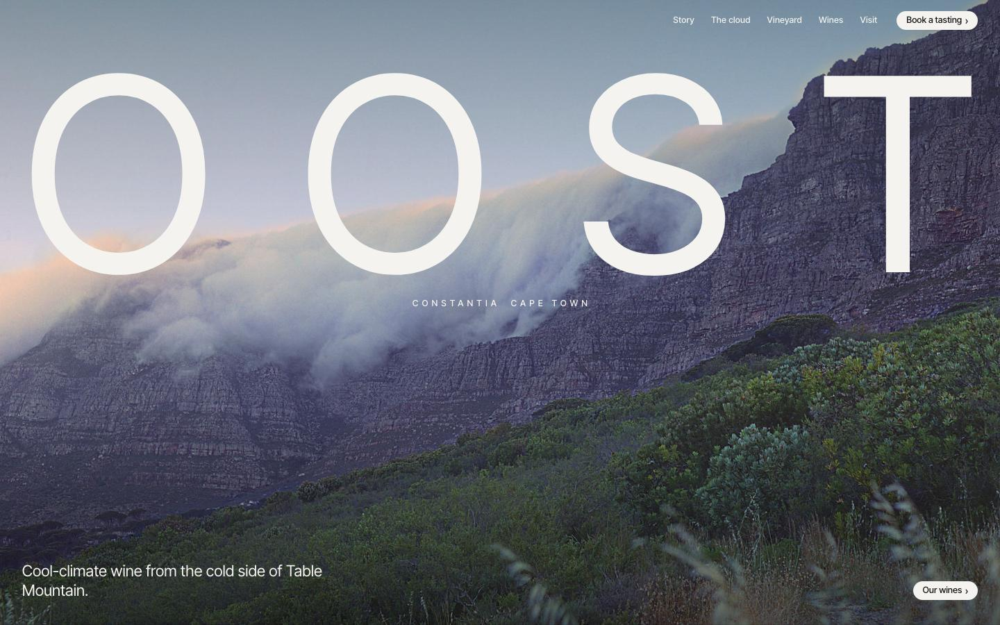

# OOST

A website for **OOST**, a fictional wine estate in Constantia, Cape Town. I built it as a portfolio piece.

[**Live site**](https://tablecloth-sage.vercel.app) · [**What's on the page**](#whats-on-the-page)

<a href="https://tablecloth-sage.vercel.app"></a>

## Why a wine estate

I wanted the most typical Cape Town business I could find. Tourism is the city's biggest visitor draw (R24.5 billion in direct spend in 2025, according to Cape Town Tourism), and wine estates lead it. So the client is a cellar door.

## The idea

Most summer afternoons the south-easter pulls a cloud over Table Mountain, and locals call it the tablecloth. On the far side of the ridge, that cloud cools the vineyards. That's why Constantia can grow cool-climate wine in a hot city. *Oost* is Dutch for east, the old Cape name for that wind, so the estate is named after it. The name is four letters, so it can run edge to edge as a wordmark. It also isn't used by any real estate.

## What's on the page

| Part | What it does | How |
|---|---|---|
| Hero | The tablecloth pouring down Table Mountain at dusk, with the wordmark spread across the full width. | One photograph and a slow settle on load. Each letter is a flex item spaced edge to edge. |
| Manifesto | One paragraph on why the estate exists. Its words light up from grey to white as you scroll. | ScrollTrigger scrub toggles a class per word. |
| Story | Text on one side and a photo on the other, full height. | CSS grid. |
| A February day | A pinned day from 06:00 to 20:00: a clock, the city and vineyard temperatures pulling apart, and one line on what's happening. The photo is washed in the sky's colour for that hour. | GSAP ScrollTrigger scrub, one screen long. The wash is a `mix-blend-mode: multiply` layer. |
| Vineyard | A map of the five blocks. As you scroll, the blocks draw in, the grapes ripen, and harvest bins roll down to the cellar while a tonnage counter climbs. Tap a block to read about it. | SVG built from one data list, with `pathLength="1"` dash offsets and `getPointAtLength`. |
| Wines | One full-screen colour panel per wine. The panels stack over each other as you scroll. Hold a glass to pour it, and tap a full glass to empty it. | `position: sticky` panels. Each glass is a button that animates an SVG every frame. A click from assistive tech pours a full glass by itself. |
| Visit and booking | Hours and address beside an aerial photo of the valley, then a tasting booking form with real validation: closed Mondays, tomorrow to six months ahead, 1–12 guests. | Client-side only. Nothing is sent, and the page says so. |

## Design choices

I looked at the award-winning wine sites first. [BRAND Napa Valley](https://brandnapavalley.com) (FINE; Gold at the 2025 w3 Awards and Best Beverage Website at the 2025 WebAwards) is the most modern of them, so I followed its system. Ashes & Diamonds, Silver Oak, Scribe, Lola, Avaline, Pasqua and Ruinart were the others I checked.

- **Type:** one grotesk, Inter Tight, standing in for BRAND's Neue Haas Unica. The wordmark is huge, the headlines are large with tight tracking, and labels are small. There are no serifs and no script.
- **Colour:** a black page. The photographs are in full colour, and each wine gets its own flat panel colour: sage, slate, terracotta or near-black.
- **Structure:** a full-bleed hero, a black manifesto, text and photo splits, colour panels, and a footer with three calls to action above the wordmark at full width again.
- **Buttons:** small white pills with a chevron, as on BRAND.

## Stack

One `index.html` plus `img/`. GSAP 3.13 + ScrollTrigger come from cdnjs, and Lenis handles smooth scroll. There's no build step. Each photo is served at 1200 and 2400 px wide (600 and 1000 px for the portrait one) through `srcset`.

```sh
python3 -m http.server 8790
```

## Photographs

From Wikimedia Commons, resized only.

- [The tablecloth over Table Mountain (hero)](https://commons.wikimedia.org/wiki/File:Cape_Town,_Table_Mountain,_Table_Cloth.jpg) by KodachromeFan, [CC BY-SA 3.0](https://creativecommons.org/licenses/by-sa/3.0)
- [Cloud around the peaks (February day)](https://commons.wikimedia.org/wiki/File:Table_Mountain_clouds.jpg) by Selsong, [CC BY-SA 3.0](https://creativecommons.org/licenses/by-sa/3.0)
- [Cloud pouring off the table (story)](https://commons.wikimedia.org/wiki/File:Clouds_in_table_mountain_(14584234627).jpg) by David Rosen from London, UK, [CC BY 2.0](https://creativecommons.org/licenses/by/2.0)
- [Constantia vineyards (visit)](https://commons.wikimedia.org/wiki/File:Constantia_vineyards.jpg) by Barry haynes, [CC BY-SA 4.0](https://creativecommons.org/licenses/by-sa/4.0)
- [Constantia Nek](https://commons.wikimedia.org/wiki/File:Walking_up_Constantia_Nek.jpg) by Michael Rowe, [CC BY-SA 4.0](https://creativecommons.org/licenses/by-sa/4.0)

## Details

- `prefers-reduced-motion`: no smooth scroll and no settle on load. The manifesto shows in full, and the day scrub follows the scrollbar directly.
- On phones the splits stack, and the wine panels stop stacking so that no text is hidden under the next panel.
- Visible focus rings, labelled form fields, and error messages tied to their inputs.

OOST, its address, wines and temperatures are made up.
