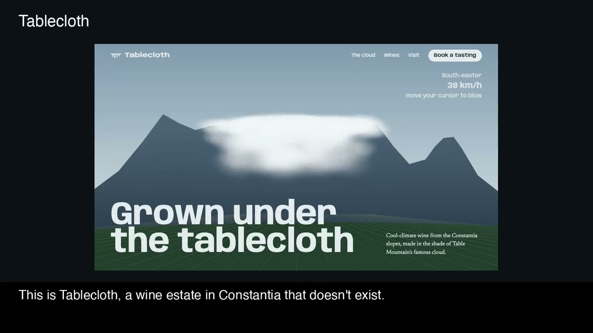

# Tablecloth

A website for **Tablecloth**, a fictional wine estate in Constantia, Cape Town. I built it as a portfolio piece.

[**Live site**](https://tablecloth-sage.vercel.app) · [**Walkthrough video**](https://tablecloth-sage.vercel.app/docs/walkthrough.mp4) · [**What's on the page**](#whats-on-the-page)

<a href="https://tablecloth-sage.vercel.app/docs/walkthrough.mp4"></a>

<sub>An 83-second narrated tour of the site and the code behind it. Also in the repo as <a href="docs/walkthrough.mp4">docs/walkthrough.mp4</a>.</sub>

## Why a wine estate

I wanted the most typical Cape Town business I could find. Tourism is the city's biggest visitor draw (R24.5 billion in direct spend in 2025, according to Cape Town Tourism), and wine estates lead it. So the client is a cellar door.

## The idea

Most summer afternoons the south-easter pulls a cloud over Table Mountain, and locals call it the tablecloth. On the far side of the ridge, that cloud cools the vineyards. That's why Constantia can grow cool-climate wine in a hot city. I named the estate after the cloud and made the site about it.

## What's on the page

| Section | Motion | How |
|---|---|---|
| About | Plain words on what the estate is, then the four steps: grow, pick, make, pour. | Static. It's there to explain the business. |
| Hero | The tablecloth rests on the mountain, then pours down the face and evaporates as it sinks. Moving the cursor pushes the cloud around. | Canvas: ~400 soft particles (~220 on phones) that rest on the table, then fall and stretch into streaks. They fade as they drop into warmer air. |
| A February day | Pinned scroll scrub from 06:00 to 20:00, one screen long. The sky changes colour and the sun arcs across. The cloud spills over at 13:30, and the city and vineyard temperatures pull apart. | GSAP ScrollTrigger scrub. All five moments stay listed as a timeline, and the current one is highlighted. |
| Vineyard | A map of the five blocks below the mountain. As you scroll, the blocks draw in, the grapes ripen to their own colour, and harvest bins roll down the farm tracks to the cellar while a tonnage counter climbs. Tap a block for its grape, height, planting year and wine. | SVG built from one data list. Outlines and vine rows draw with `pathLength="1"` dash offsets, and the bins follow each track with `getPointAtLength`. Runs only while the whole map is on screen. |
| Wines | Hold a glass (finger, mouse, Space or Enter) and a bottle lifts, tips and pours until you let go. Tap a full glass to empty it. | Each glass is a button. The fill level, bottle tilt and stream are set every animation frame on an SVG clipped to the bowl. A click from assistive tech pours a full glass by itself. |
| Visit | Tasting booking with real validation: closed Mondays, tomorrow to six months ahead, 1–12 guests. | Client-side only. Nothing is sent, and the page says so. |

## Design choices

- **Palette:** cool fog, mountain slate, vineyard green, pale Sauvignon gold and a protea pink for focus and errors. I avoided the warm cream every wine site uses, because this estate's story is about cold.
- **Type:** Anybody (a variable-width grotesque) for display, set narrow for section headings and wide for the hero. Newsreader for reading. The hero headline stays still so the cloud behind it gets all the attention.
- **One bold thing:** the cloud. Everything else stays quiet.

## Stack

One `index.html`. GSAP 3.13 + ScrollTrigger from cdnjs, Lenis for smooth scroll. There's no build step and there are no images: the mountain, cloud and glasses are drawn in code.

```sh
python3 -m http.server 8790
```

## Details

- `prefers-reduced-motion`: no smooth scroll, and the cloud is drawn as a still frame. The day scrub follows the scrollbar directly.
- Phones get a tighter crop on the mountain, fewer particles, a single-column layout and only the current timeline moment.
- Visible focus rings, labelled form fields, and error messages tied to their inputs.

Tablecloth, its address, wines and temperatures are made up.
